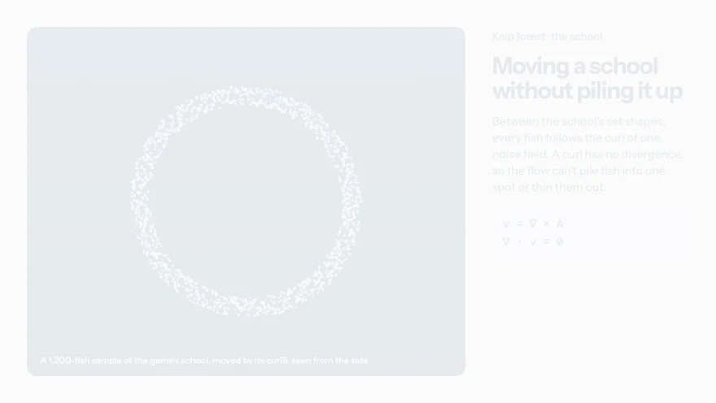
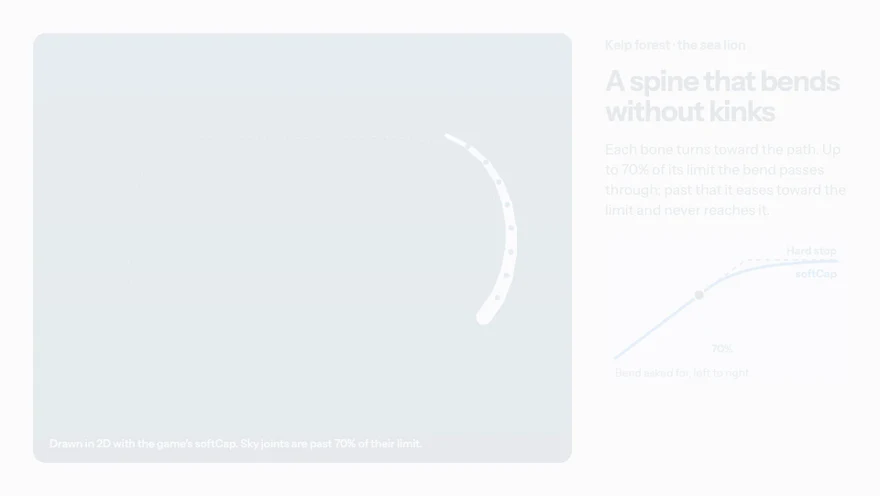
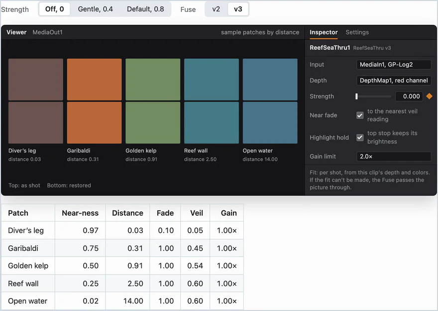
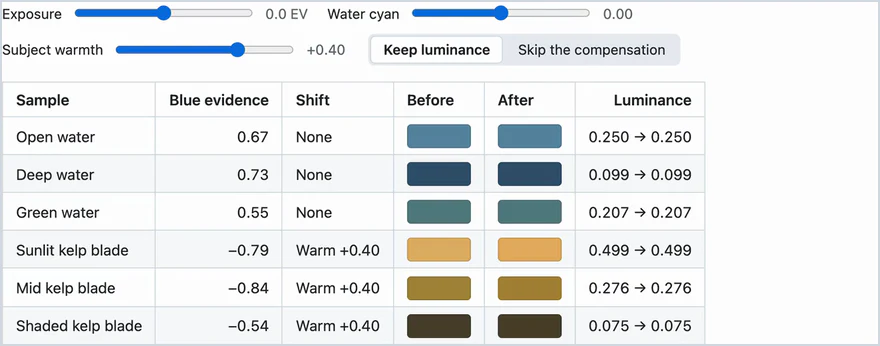
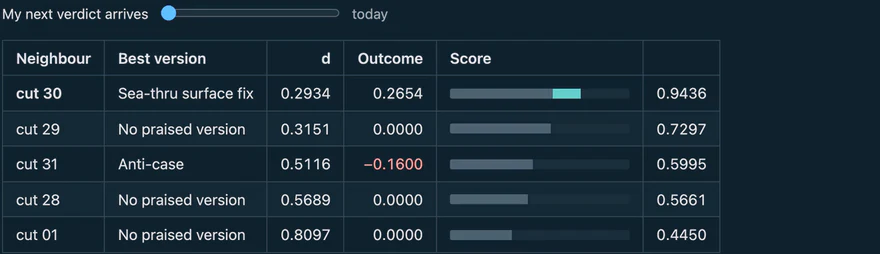
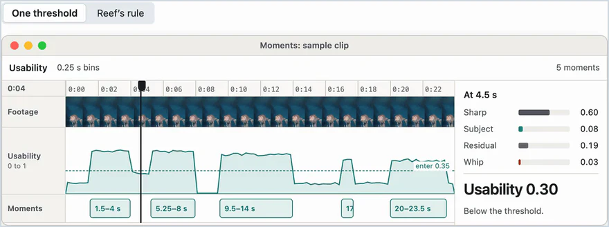
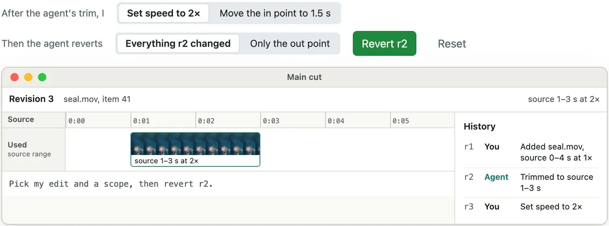
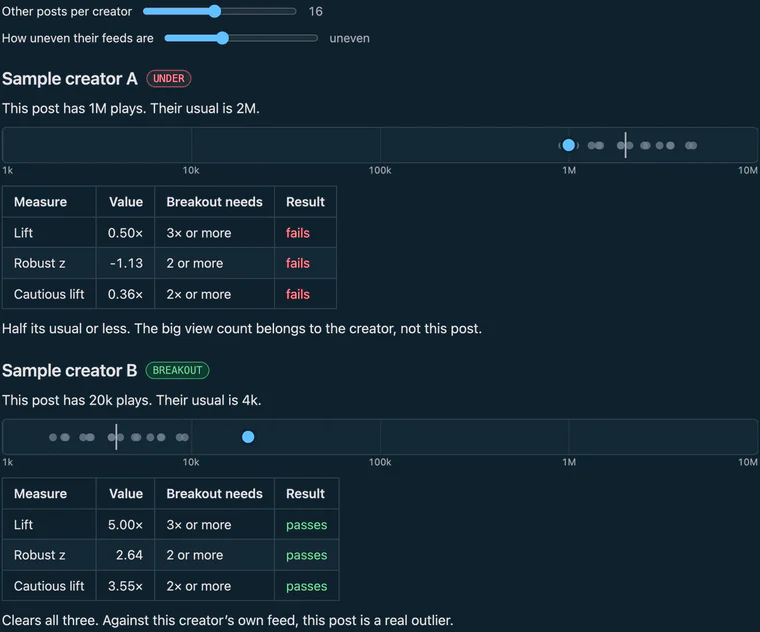

<picture>
  <source media="(prefers-color-scheme: dark)" srcset="assets/banner-dark.svg">
  
</picture>

Eight pieces of math from software I built, written up to show how changing an input changes the result. Six come from [Reef](https://github.com/henryhcooperr/reef) (a Mac app for dive footage), [Grade Lab](https://github.com/henryhcooperr/grade-lab) (an agent that color grades in DaVinci Resolve) and [Social Lab](https://github.com/henryhcooperr/reef-social-lab) (research on public posts). Two come from my kelp forest game: curl noise that moves a school of fish, and a soft bend limit for a sea lion's spine.

**[Case study and the film](https://work.henrycooper.dev/work/algorithm-studies/)** · [Portfolio](https://work.henrycooper.dev) · [All my work](https://github.com/henryhcooperr)

The products' code is private; these write-ups are public. Each figure comes from a JavaScript port of the real function with its real constants. The inputs are samples I made to show one behavior clearly, so none of the numbers are measurements unless the text says so.

1. [Moving a school without piling it up](#moving-a-school-without-piling-it-up), from the kelp forest game
2. [A spine that bends without kinks](#a-spine-that-bends-without-kinks), from the kelp forest game
3. [Giving color back with distance](#giving-color-back-with-distance), from Grade Lab's Sea-thru Fuse
4. [Pushing water cyan without touching the fish](#pushing-water-cyan-without-touching-the-fish), from Grade Lab's look node
5. [Starting from a grade I already liked](#starting-from-a-grade-i-already-liked), from Grade Lab's case memory
6. [Where a moment starts and stops](#where-a-moment-starts-and-stops), from Reef's moment finder
7. [Undoing one edit and keeping the rest](#undoing-one-edit-and-keeping-the-rest), from Reef's timeline history
8. [Calling a post a breakout](#calling-a-post-a-breakout), from Social Lab's scoring

## Moving a school without piling it up

The school in my kelp forest game is 4,096 fish on a desktop and 1,536 on a phone. On each of the game's six beats the school gathers into a set shape, and between beats it pours along curl noise: each fish's velocity is the curl of a field built from three sine waves at different scales. A curl has no divergence, so the flow can't pile fish into one spot or thin them out in another, and no fish has to look at its neighbors.

Where every fish should be on each beat is baked into one 64 × 384 RGBA32F texture, one texel per fish per beat, and the GPU reads it per fish. Each fish's sway starts at its index times 0.618 of a turn, so neighbors never sway in step.



<sub><b>Captured from the site's live figure.</b> It runs <code>curl3</code> copied from the kelp forest game, with the same constants.</sub>

## A spine that bends without kinks

The sea lion in my kelp forest game keeps a trail of where its chest has been, measured by distance traveled. Each spine bone turns to the trail's direction at that bone's own distance behind the chest, so a turn curves the whole body and a climb ripples back to the tail.

Each bone has a bend limit. Mine passes the angle through unchanged up to 70% of the limit, then eases toward the limit without reaching it, with no jump in the angle or its slope. A bone near its limit passes the rest of the turn to the next one, so a hard turn bends the back, hips and tail into one even crescent.



<sub><b>Captured from the site's live figure.</b> It runs <code>softCap</code> copied from the kelp forest game, with the same constants.</sub>

## Giving color back with distance

Water takes red away with distance and lays a blue-green veil over everything. Grade Lab undoes that in a Fusion Fuse I wrote, ReefSeaThru, which reads distance from Resolve's own Depth Map.

Version 2 restored color everywhere. On cut 30, a shot from one of my dives, I said "i guess it does become pink tho and the divers leg does look worse." Closer in than the nearest point where the Fuse can measure the veil, there's almost no water to take out, so v2 was subtracting a veil that wasn't there. Version 3 fades the restoration out over that last stretch, down to none on the nearest thing in the frame.



<sub><b>Rebuild, sample patches.</b> Resolve's Fusion page rebuilt, not a screen capture. The patch colors and the fit are samples; the restoration is a port of the Fuse's v3 kernel with its real limits: veil at most 0.6, gain at most 2×, color shift at most 1.4×.</sub>

## Pushing water cyan without touching the fish

A global hue shift turns the water cyan and the garibaldi green with it. Grade Lab's look node decides per pixel instead. It measures how blue a pixel is relative to its brightest channel, `(b − r) / peak`. Pixels with enough blue evidence get the water shift, pixels with the opposite evidence get the warm shift, and each pixel is rescaled to the luminance it started with, so the shift changes hue and not exposure.



<sub><b>Rebuild.</b> The six colors are averaged from patches of one of my kelp frames. The figure runs only exposure and the selective step.</sub>

```python
def _selective_color(rgb, water_cyan, subject_warmth):
    peak = max(positive.max(-1), 1e-5)
    L = rgb @ REC709                          # 0.2126, 0.7152, 0.0722
    blue = (b - r) / peak
    tonal = ss(L, .005, .04) * (1 - ss(L, .65, 1.0))
    w = ss(blue, .08, .40) * tonal * water_cyan
    k = ss(-blue, .06, .35) * tonal * subject_warmth
    gains = (1 - .12*w + .18*k,  1 - .16*w + .02*k,  1 + .20*w - .12*k)
    shifted = rgb * gains
    return shifted * (L / luminance(shifted))   # same brightness, new hue
```

<sub>Condensed from Grade Lab's color code. <code>ss</code> is smoothstep: a = clip((v − lo) / (hi − lo)), then a²(3 − 2a).</sub>

## Starting from a grade I already liked

Grade Lab doesn't average my past grades. For a new shot it measures 17 numbers from the camera signal as a fingerprint, z-scores each across the library, and takes the root mean square of the differences as the distance `d` to an old shot. Each past version also has an outcome, a score drawn from my verdicts on it, and it halves for every 21 days since my newest verdict. Of the five nearest shots, the seed is the praised one with the best `e^(−d) · (1 + max(0, outcome))`.



<sub><b>Rebuild.</b> The rows are real: the pick for cut 32, replayed with cut 32's own feedback left out. The later dates are hypothetical.</sub>

## Where a moment starts and stops

Reef's moment finder scores every quarter second for how usable it is: `0.4·sharp + 0.6·subject + 0.15·residual − 0.5·whip`, where whip is camera motion times blur. A single threshold on that curve breaks one shot into fragments, so a run starts at 0.35 and keeps going until it falls below 0.22. Runs less than 2 seconds apart merge, and anything shorter than 2 seconds after merging is dropped. Those values were set on my own dive clips.



<sub><b>Rebuild.</b> The signals are a sample shaped like a seal clip with a camera flip at 8 s.</sub>

## Undoing one edit and keeping the rest

The agent trims a shot. Then I change its speed. Now I want the agent's trim gone and my speed kept. Reef's `history.revert` undoes the changes one revision made and keeps every later change to other fields. It writes a new revision instead of rewriting old ones, refuses if a field it would undo was changed again later, and says who changed it. An agent can only revert agent revisions.



<sub><b>Rebuild, sample clip.</b> The refusal's code, message and next step are the engine's own wording.</sub>

## Calling a post a breakout

A million views means nothing for a creator who averages two million. Social Lab only calls a post a breakout when it beats the creator's own feed on three measures at once: lift of at least 3, robust z of at least 2 and cautious lift of at least 2. It won't score a creator with fewer than ten other posts.

<p align="center"></p>

<p align="center"><sub><b>Sample data.</b> Both feeds are synthetic, and the scoring is a port of the real scorer.</sub></p>

| Measure | Defined as | Why |
| --- | --- | --- |
| **Lift** | plays ÷ median plays of the creator's other posts | The median ignores the one viral post that would drag a mean upward. |
| **Robust z** | (ln plays − median ln plays) ÷ (1.4826 × MAD) | Views are heavy-tailed, so it works in logs and uses the median absolute deviation, scaled to match a standard deviation. |
| **Cautious lift** | plays ÷ the 95th percentile of 2,000 bootstrapped medians | A lower bound: the lift still holds if the creator's usual turns out to be higher than it looks. |

## The house rule

Each port was made from one function at one private commit: Reef at `9d2b7ffca`, Grade Lab at `62d3d87`. The film at the top of the case study runs `curl3` and `softCap` copied from the kelp forest game. When a port and its source disagree, the source is right and the port is a bug. If a figure looks wrong, please open an issue.

The figures run only the step they study. The real functions do more.

---

More: [Reef](https://github.com/henryhcooperr/reef) · [Grade Lab](https://github.com/henryhcooperr/grade-lab) · [Social Lab](https://github.com/henryhcooperr/reef-social-lab) · [Coopr](https://github.com/henryhcooperr/coopr) · [Portfolio](https://work.henrycooper.dev)
