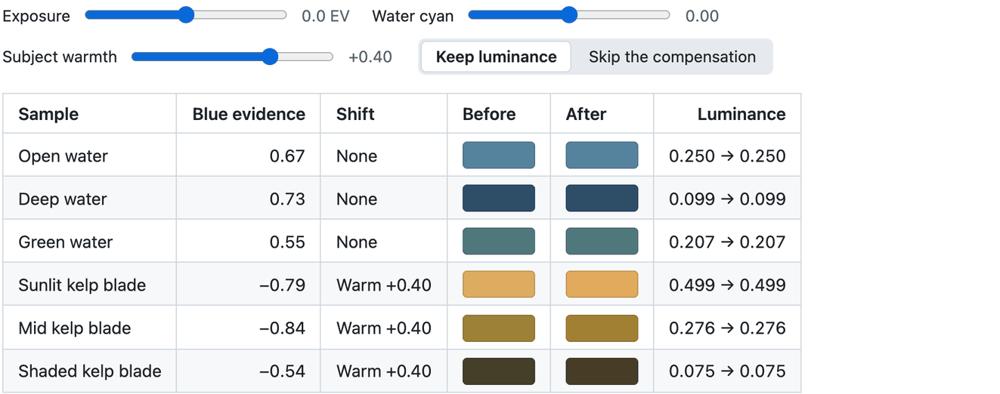
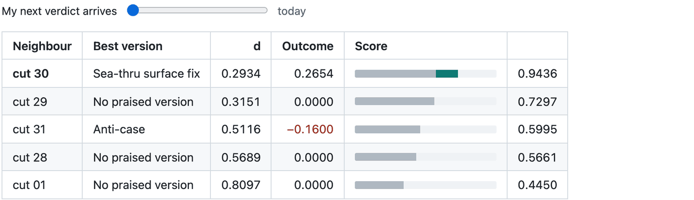
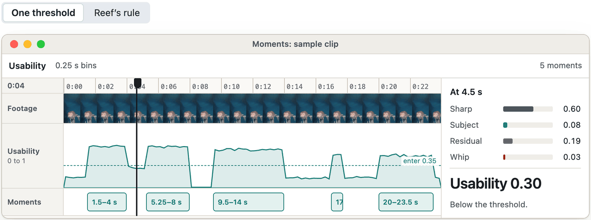
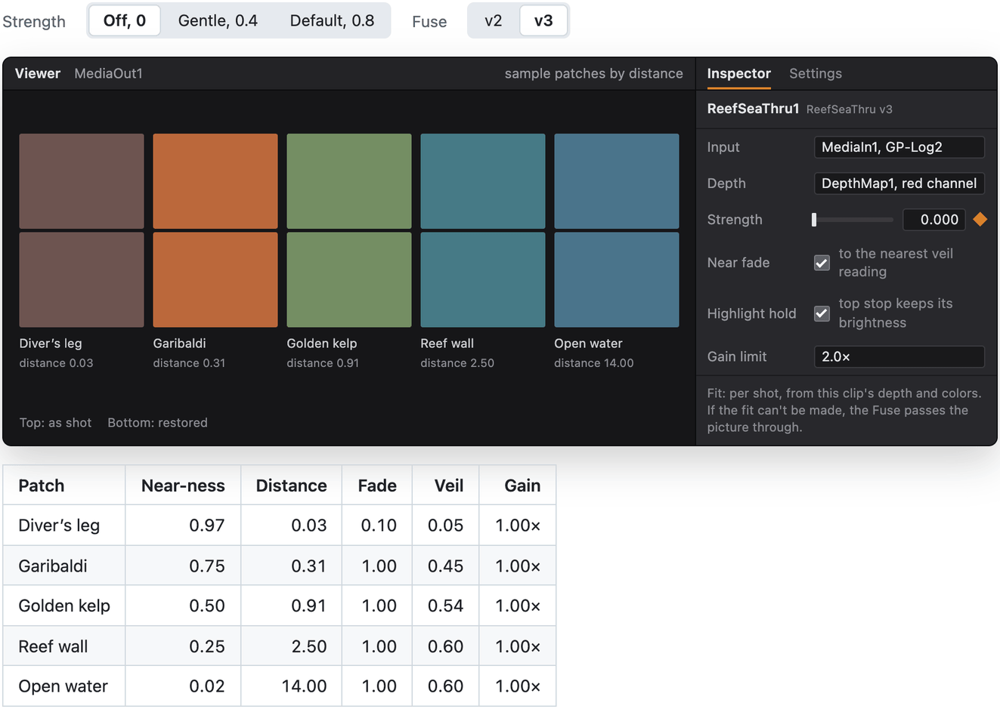
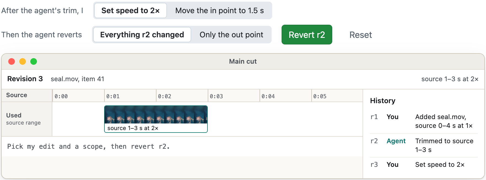

# Reef algorithm studies

**Six pieces of math from Reef, Grade Lab and Social Lab, written up to show how changing an input changes the decision.** The products are private. These studies aren't. Each figure comes from a JavaScript port of the real function with its real constants. The inputs are samples I made to show one behavior clearly, so none of the numbers below are measurements unless the text says so.

- [Pushing water cyan without touching the fish](#pushing-water-cyan-without-touching-the-fish), from Grade Lab's look node
- [Starting from a grade I already liked](#starting-from-a-grade-i-already-liked), from Grade Lab's case memory
- [Where a moment starts and stops](#where-a-moment-starts-and-stops), from Reef's moment finder
- [Giving color back with distance](#giving-color-back-with-distance), from Grade Lab's Sea-thru Fuse
- [Undoing one edit and keeping the rest](#undoing-one-edit-and-keeping-the-rest), from Reef's timeline history
- [Calling a post a breakout](#calling-a-post-a-breakout), from Social Lab's scoring

## Pushing water cyan without touching the fish

A global hue shift turns the water cyan and the garibaldi green with it. Grade Lab's look node decides per pixel instead. It measures how blue a pixel is relative to its brightest channel, `(b − r) / peak`. Pixels with enough blue evidence get the water shift, pixels with the opposite evidence get the warm shift, and a tonal window leaves crushed shadows and clipped highlights alone. Then it rescales each pixel back to the luminance it started with, so the shift changes hue and not exposure.

<p align="center"></p>

<sub>The six colors are averaged from patches of one of my Catalina kelp frames, as displayed, then decoded to linear light with the Rec.709 curve. The figure runs only exposure and the selective step. The real node also applies white balance, contrast, saturation and the log shoulder, and every recipe is constant per shot.</sub>

```python
def _selective_color(rgb, water_cyan, subject_warmth):
    peak = max(positive.max(-1), 1e-5)
    L = rgb @ REC709                          # 0.2126, 0.7152, 0.0722
    blue = (b - r) / peak
    tonal = ss(L, .005, .04) * (1 - ss(L, .65, 1.0))
    w = ss(blue, .08, .40) * tonal * water_cyan
    k = ss(-blue, .06, .35) * tonal * subject_warmth
    gains = (1 - .12*w + .18*k,  1 - .16*w + .02*k,  1 + .20*w - .12*k)
    shifted = rgb * gains
    return shifted * (L / luminance(shifted))   # same brightness, new hue
```

<sub>Condensed from <code>color.py</code> in reef-grade-lab. <code>ss</code> is smoothstep: a = clip((v − lo) / (hi − lo)), then a²(3 − 2a).</sub>

## Starting from a grade I already liked

Grade Lab doesn't average my past grades. For a new shot, it measures a fingerprint of 17 numbers: luminance percentiles, saturation, haze, how much of the frame is water and what hue it is, warm share, structure, and the red/blue and green/blue ratios. Each number is z-scored across the library. The distance `d` to an old shot is the root mean square of the differences. Every verdict I give is stored with its date, and a version's outcome is the sum of its verdicts' signs times their weights, halved for every 21 days since my newest verdict. Of the five nearest shots, the seed is the praised one with the best `e−d · (1 + max(0, outcome))`.

The table uses the real case rows for cut 32. The loop pushes my next verdict later and later to show what happens to them.

<p align="center"></p>

**Seed:** cut 30, Sea-thru surface fix, score 0.9436. My praise now counts for 100% of what it did.

<sub>Grey is similarity, e−d. Teal is the lift from my praise. Cut 31's best version is an anti-case, so its negative outcome never lowers its score; Grade Lab returns it on a separate list of grades to avoid. The rows are the real ones from the cut 32 replay, with cut 32's own feedback excluded. The later dates are hypothetical.</sub>

## Where a moment starts and stops

Reef's moment finder scores every quarter second for how usable it is: `0.4·sharp + 0.6·subject + 0.15·residual − 0.5·whip`, where whip is camera motion times blur. A single threshold on that curve breaks one shot into fragments. The seal turns away for a second, or I flip the camera to follow it, and one moment becomes three. So a run starts at 0.35 and keeps going until it falls below 0.22. Runs less than 2 seconds apart merge, and anything shorter than 2 seconds after merging is dropped. Those values were set on my own dive clips.

<p align="center"></p>

<sub>A rebuild in Reef's design system, not a screen capture. The signals are a sample shaped like a seal clip with a camera flip at 8 s. The rule is a port of <code>usable_runs</code> from <code>moment/segment.py</code>.</sub>

## Giving color back with distance

Water takes red away with distance and lays a blue-green veil over everything. Grade Lab undoes that in a Fusion Fuse I wrote, ReefSeaThru, which runs on the camera's log footage before the grade. It reads distance from Resolve's own Depth Map, where brighter means nearer. For each shot it fits the veil color, how fast the veil builds, how fast each channel fades, and the distance of the nearest veil reading. Then it removes the veil and gives each channel back its loss, with the gain capped at 2×.

Version 2 did that everywhere. On cut 30 I said "i guess it does become pink tho and the divers leg does look worse." Nearer than the nearest veil reading, there's almost no water to take out, so v2 was subtracting a veil that wasn't there. Version 3 fades the restoration out along that path, down to none at the nearest thing, and holds back highlights so they don't brighten past clipping.

<p align="center"></p>

<sub>A rebuild of Resolve's Fusion page, not a screen capture. The patch colors and the fit are samples, made with the textbook model I = J·e−βz + B(1 − e−βz). The restoration itself is a port of the Fuse's v3 kernel, with its real limits: veil at most 0.6, gain at most 2×, color shift at most 1.4×. Distance is in the depth map's relative units, not meters. Both rows go through the same fixed preview transform.</sub>

## Undoing one edit and keeping the rest

An undo stack can't do this. The agent trims a shot. Then I change its speed. Now I want the agent's trim gone and my speed kept. Reef's `history.revert` undoes the changes one revision made and keeps every later change to other fields. It writes a new revision instead of rewriting old ones. It refuses if any field it would undo was changed again later, and it says who changed it. A revert applies whole or not at all, and an agent can only revert agent revisions.

<p align="center"></p>

<sub>A rebuild in Reef's design system, with a sample clip. The refusal's code, message and next step are the engine's own wording, from <code>revise_ops/history.py</code>. A revert is itself a revision, so it can be reverted too.</sub>

## Calling a post a breakout

A million views means nothing for a creator who averages two million. Social Lab only calls a post a breakout when it beats the creator's own feed on three measures at once, and it won't score a creator with fewer than ten other posts.

| Measure | Defined as | Why |
| --- | --- | --- |
| **Lift** | plays ÷ median plays of the creator's other posts | The median ignores the one viral post that would drag a mean upward. |
| **Robust z** | (ln plays − median ln plays) ÷ (1.4826 × MAD) | Views are heavy-tailed, so it works in logs and uses the median absolute deviation, scaled to match a standard deviation. |
| **Cautious lift** | plays ÷ the 95th percentile of 2,000 bootstrapped medians | A lower bound: the lift still holds if the creator's usual turns out to be higher than it looks. |

| Label | Rule |
| --- | --- |
| `SPARSE_UNSCORED` | Fewer than 10 other posts |
| `BREAKOUT` | Lift ≥ 3, robust z ≥ 2 and cautious lift ≥ 2 |
| `EXTREME` | A breakout with lift ≥ 10 |
| `TYPICAL` | Lift from 0.67 to 1.5 |
| `UNDER` | Lift ≤ 0.5 |
| `BETWEEN` | Everything else |

The [reef-social-lab](https://github.com/henryhcooperr/reef-social-lab) page shows the calculator at work.

## Notes

Each port follows one function in one commit: Reef at `9d2b7ffca`, Grade Lab at `62d3d87`. The derivations, the parts left out, and where each constant came from are in `notes/`. When a port and its source disagree, the source is right and the port is a bug. Please open an issue.

## Related

- [henryhcooperr profile](https://github.com/henryhcooperr)
- [reef](https://github.com/henryhcooperr/reef)
- [reef-grade-lab](https://github.com/henryhcooperr/reef-grade-lab)
- [reef-social-lab](https://github.com/henryhcooperr/reef-social-lab)
- [coopr](https://github.com/henryhcooperr/coopr)
